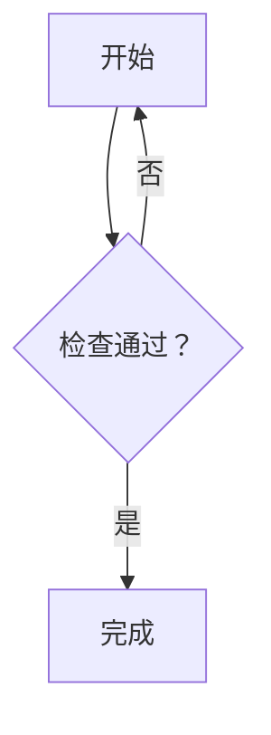

# Markdown Preview

A read-only Markdown preview rendered by Goldmark, registered as an Open With action. Use the floating preview icon to replace the editor, or the split button to show source and preview side by side. Native edits automatically update the preview.

Supports Markdown images, links (including automatic URL links), and GFM tables with column alignment. Images can use paths relative to the Markdown file within the workspace or HTTP(S) URLs. Links open workspace documents or the system browser. Image loading runs on a background worker and is cached for the preview session; unavailable images do not hide the document.

Use Ctrl+F (Cmd+F on macOS) to search the rendered preview text. Matches are highlighted on the page; Enter / Shift+Enter and F3 / Shift+F3 navigate between them and scroll the current match into view. Case-sensitive, whole-word and regular-expression search use the workbench find bar. Search updates when the document changes.

Inline code (including double-backtick spans), fenced code blocks, and indented code blocks support syntax highlighting. Add a language after the opening fence, such as `go`, `js`, or `python`, for language-specific highlighting. Unlabelled snippets use automatic detection and shared lexical highlighting. Code colors follow the editor theme.

Use a `mermaid` fence for flowcharts. Rendering runs locally in the extension, including on remote workspace servers, without JavaScript or a browser. Labels use native text for Chinese font support and theme colors. Compact spacing and automatic wrapping of long node labels reduce the canvas width; wide diagrams still scroll horizontally. Ordinary nodes have rounded, tinted surfaces, decisions have dashed outlines, and branch labels have rounded borders. Native surfaces and labels follow the editor theme. Invalid or oversized diagrams show an error and their highlighted source while keeping the rest of the document visible. Rendered code and diagrams share a bounded cache.

Vertical branching trees keep the longest continuation on a straight path and pack side branches alongside it. Connectors have rounded turns, with branch labels beside the vertical segment leading to their target. Joins, loops, subgraphs and horizontal diagrams use Mermaid's layout.

````markdown

````

Supports Mermaid `graph` / `flowchart` syntax with directions, branches, loops, subgraphs and multiline labels. Flowchart source is limited to 32 KiB and the rendered canvas to 2048 × 2048 pixels.

Uses the [Pencode](https://github.com/pencode-labs/pencode) peb v20 SDK. Requires Go 1.27.0 or newer.

## Build and install

```sh
git clone git@github.com:pencode-labs/markdown-preview.git
cd markdown-preview
go build -o bin/markdown-preview .
```

In Pencode's extension manager, choose **Install from local directory** and select this checkout. Extensions run on the workspace server, so build and install on that host for remote workspaces.

On Windows, build `bin/markdown-preview.exe` and set `entry` in `resources/extension.json` to `bin/markdown-preview.exe` before installing.

## Development

```sh
go test .
```

## License

MIT. See [LICENSE](LICENSE).

## Releases

Push a version tag such as `v0.1.0` to test, cross-compile and publish a GitHub
Release automatically. Linux, macOS (`darwin`) and Windows each support `amd64`
and `arm64`. Prerelease tags such as `v0.2.0-rc.1` create prereleases.

Assets use `<extension-id>-<tag>-<os>-<arch>.zip`, accompanied by `SHA256SUMS`.
Each ZIP has one top-level `<extension-id>/` directory containing `bin/`,
`resources/extension.json`, the README, license and all resource notices. The
packaged manifest uses the tag version and Windows entries include `.exe`.

Download the archive matching the **workspace server's** OS and architecture.
Extract it directly into `~/.pencode/extensions/` (Windows:
`%USERPROFILE%/.pencode/extensions/`), preserving executable permissions. For
example, `unzip markdown-preview-v0.1.0-linux-amd64.zip -d ~/.pencode/extensions/` installs
`~/.pencode/extensions/markdown-preview/resources/extension.json`. Restart Pencode to discover the extension.
For remote workspaces, extract on the remote server. You can also select the
extracted `<extension-id>/` directory in the extension manager's local-directory
installation flow. No Go toolchain is needed to use a release package; extension
specific tools described above still need to be available on the workspace server.
