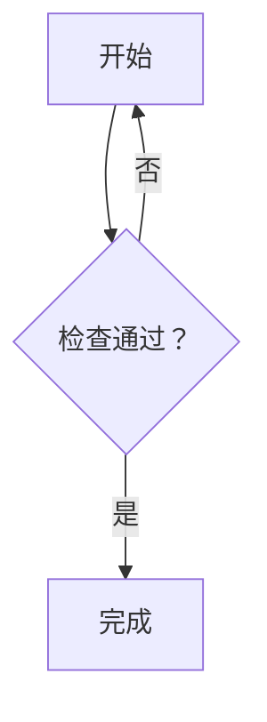

# Markdown Preview

A read-only Markdown preview rendered by Goldmark, registered as an Open With action. Use the floating preview icon to replace the editor, or the split button to show source and preview side by side. Native edits automatically update the preview.

Supports Markdown images, links (including automatic URL links), and GFM tables with column alignment. Images can use paths relative to the Markdown file within the workspace or HTTP(S) URLs. Links open workspace documents or the system browser. Image loading runs on a background worker and is cached for the preview session; unavailable images do not hide the document.

Use Ctrl+F (Cmd+F on macOS) to search the rendered preview text. Matches are highlighted on the page; Enter / Shift+Enter and F3 / Shift+F3 navigate between them and scroll the current match into view. Case-sensitive, whole-word and regular-expression search use the workbench find bar. Search updates when the document changes.

Inline code (including double-backtick spans), fenced code blocks, and indented code blocks support syntax highlighting. Add a language after the opening fence, such as `go`, `js`, or `python`, for language-specific highlighting. Unlabelled snippets use automatic detection and shared lexical highlighting. Code colors follow the editor theme.

Use a `mermaid` fence for flowcharts. Rendering runs locally in the extension, including on remote workspace servers, without JavaScript or a browser. Labels use native text for Chinese font support and theme colors. Compact spacing and automatic wrapping of long node labels reduce the canvas width; wide diagrams still scroll horizontally. Ordinary nodes have rounded, tinted surfaces, decisions have dashed outlines, and branch labels have rounded borders. Native surfaces and labels follow the editor theme. Invalid or oversized diagrams show an error and their highlighted source while keeping the rest of the document visible. Rendered code and diagrams share a bounded cache.

Vertical branching trees keep the longest continuation on a straight path and pack side branches alongside it. Connectors have rounded turns, with branch labels beside the vertical segment leading to their target. Joins, loops, subgraphs and horizontal diagrams use Mermaid's layout.

````markdown

````

Supports Mermaid `graph` / `flowchart` syntax with directions, branches, loops, subgraphs and multiline labels. Flowchart source is limited to 32 KiB and the rendered canvas to 2048 × 2048 pixels.

Uses the [Pencode](https://github.com/pencode-labs/pencode) peb v14 SDK. Requires Go 1.27.0 or newer.

## Build and install

```sh
git clone git@github.com:pencode-labs/markdown-preview.git
cd markdown-preview
go build -o bin/markdown-preview .
```

In Pencode's extension manager, choose **Install from local directory** and select this checkout. Extensions run on the workspace server, so build and install on that host for remote workspaces.

On Windows, build `bin/markdown-preview.exe` and set `entry` in `resources/extension.json` to `bin/markdown-preview.exe` before installing.

## Development

```sh
go test .
```

## License

MIT. See [LICENSE](LICENSE).

## Releases

Push a `v*` tag (for example, `v0.1.0`) to this repository, or publish a GitHub Release,
to test and build Linux, macOS and Windows packages for amd64 and arm64. The workflow
uploads ZIP archives and `SHA256SUMS` to the matching release, creating it if needed.
Prerelease tags such as `v0.1.0-rc.1` create prereleases.

Each ZIP contains `bin/`, `resources/`, the README and license. Its manifest uses the
tag version and the correct executable suffix for Windows. Download the package
for the workspace server's OS and architecture, extract it, then install the
extracted directory through Pencode's extension manager.
